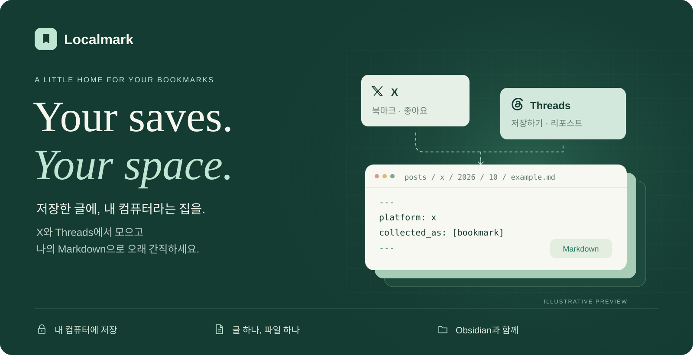
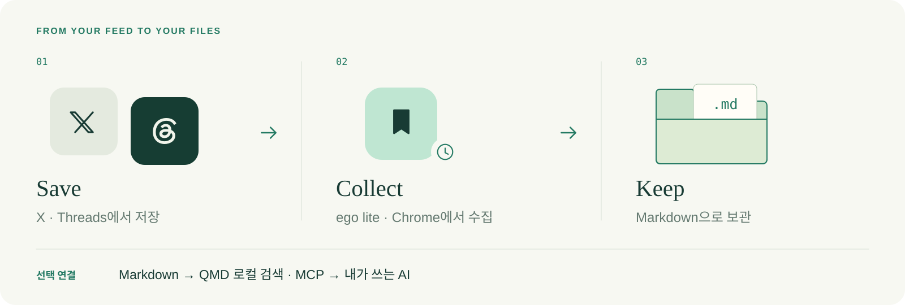
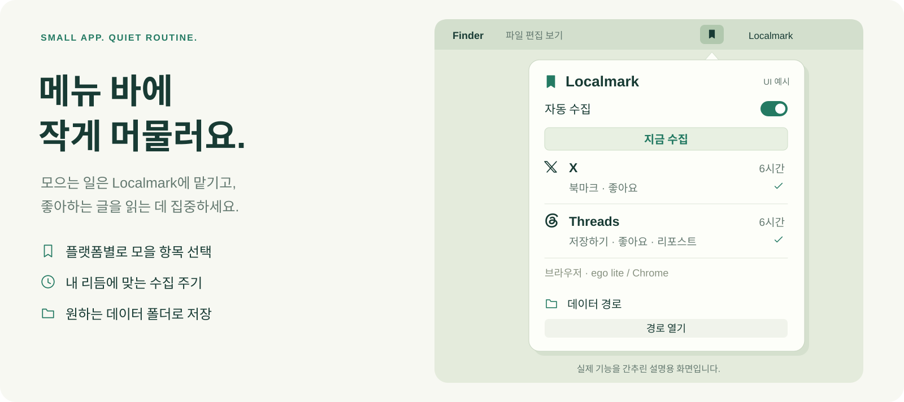
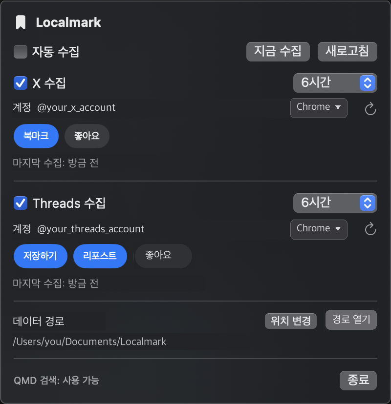
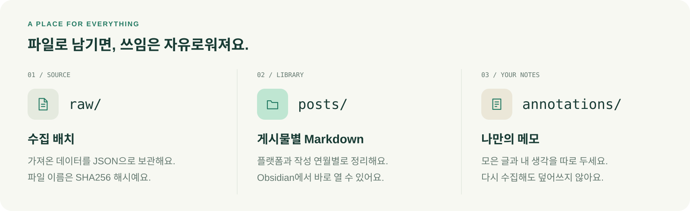

# Localmark

**X와 Threads에서 저장한 글을 로컬 Markdown으로 만드는 macOS 수집기입니다.**

북마크·좋아요·리포스트를 Obsidian 호환 Vault에 보관하고, 원문과 출처 메타데이터를 남깁니다. Localmark는 **수집 → Markdown 저장**에 집중합니다. 검색·AI 대화가 필요하면 QMD나 원하는 RAG 도구를 선택해 연결할 수 있습니다.

## 지원하는 수집 항목

| 플랫폼     | 수집 항목           | 수집 화면                              |
| ------- | --------------- | ---------------------------------- |
| X       | 북마크, 좋아요        | 로그인 계정의 북마크·좋아요 목록                 |
| Threads | 저장하기, 좋아요, 리포스트 | `/saved`, `/liked`, `/@계정/reposts` |

각 항목은 독립적으로 켜고 끌 수 있습니다. 수집 브라우저는 **ego lite와 Google Chrome**을 지원하며 X와 Threads에서 각각 선택할 수 있습니다.

## 동작 방식



Localmark는 선택한 브라우저의 로그인 세션을 이용해 화면에서 글을 읽고 Markdown과 원시 수집 배치를 저장합니다. 검색 인덱스와 답변 생성은 코어에서 분리되어 있습니다.

## 메뉴 바



<details>
<summary>실제 메뉴 바 화면 보기</summary>



</details>

계정 입력란에 아이디를 넣어 로그인하는 방식이 아닙니다. 첫 수집 성공 시 선택한 브라우저에서 계정을 자동 감지해 저장하며, 이후 계정이 바뀌면 수집하지 않고 `현재 계정으로 변경` 버튼을 표시합니다.

브라우저와 수집 항목은 코어가 제공하는 역량 정보로 그립니다. 따라서 지원하지 않는 브라우저나 수집 항목을 선택 가능한 것처럼 보여 주지 않습니다.

## 빠른 시작

QMD 없이 수집과 Markdown 저장만 사용할 수 있습니다. Obsidian도 필수가 아닙니다.

### 1. 설치

```sh
git clone https://github.com/devjiro76/localmark.git localmark
cd localmark
corepack yarn install
```

ego lite를 사용할 경우 첫 실행 설정을 완료한 뒤 명령을 확인합니다. 이 과정에서 보통 `~/.local/bin`에 `ego-browser`를 등록합니다.

```sh
export PATH="$HOME/.local/bin:$PATH"
command -v ego-browser
ego-browser skill
```

Chrome은 첫 수집이나 계정 확인 때 Localmark 전용 프로필로 자동 실행됩니다. 평소 쓰는 Chrome 창과 기본 프로필은 사용하지 않으며, 전용 프로필은 `~/Library/Application Support/Localmark/chrome-profile`에 저장됩니다. 로컬 CDP 연결도 이 전용 프로필에만 열립니다.

### 2. Vault 초기화

Vault는 저장소와 분리된 위치에 두는 것을 권장합니다.

```sh
corepack yarn cli init --data "$HOME/Documents/Localmark"
```

`--data`를 생략하면 `LOCALMARK_DATA_DIR`, 다시 이 값도 없으면 저장소 아래 `data/`를 사용합니다.

### 3. 로그인과 수집 확인

선택한 브라우저에서 수집할 X·Threads 계정에 사용자가 직접 로그인합니다. Localmark는 로그인 세션을 만들거나 다른 브라우저에서 복사하지 않습니다. Chrome은 Localmark가 연 전용 Chrome 창에 로그인해야 합니다.

먼저 설정과 원본 데이터를 바꾸지 않는 dry-run을 실행합니다.

```sh
corepack yarn cli sync --data "$HOME/Documents/Localmark" --dry-run

# Chrome으로 시험할 때
corepack yarn cli sync --data "$HOME/Documents/Localmark" --browser chrome --dry-run
```

결과를 확인한 뒤 실제로 수집합니다.

```sh
corepack yarn cli sync --data "$HOME/Documents/Localmark"

# Chrome으로 수집할 때
corepack yarn cli sync --data "$HOME/Documents/Localmark" --browser chrome
```

메뉴 바에서 브라우저를 선택하면 이후 자동 수집에도 그 설정이 사용됩니다. CLI의 `--browser`는 해당 실행에만 적용합니다.

X만 또는 Threads만 수집할 수도 있습니다.

```sh
corepack yarn cli sync --data "$HOME/Documents/Localmark" --platform x
corepack yarn cli sync --data "$HOME/Documents/Localmark" --platform threads
```

### 4. 메뉴 바 실행

```sh
corepack yarn app
```

로컬 `.app`으로 빌드해 실행할 수도 있습니다.

```sh
corepack yarn app:build
open "dist/Localmark.app"
```

소스에서 직접 빌드하므로 Developer ID 인증서가 필요하지 않습니다. 메뉴 바의 `데이터 경로 → 위치 변경`에서 앞서 초기화한 Vault를 선택합니다.

## 생성되는 Vault



```text
Localmark/
├── posts/                 # 플랫폼·작성 연월별 Markdown
│   ├── x/
│   └── threads/
├── annotations/           # 사용자 메모를 위한 독립 공간
├── attachments/
├── raw/                   # SHA256 이름의 원시 수집 배치
├── settings.json          # 계정·플랫폼별 수집 설정
└── .localmark/
    └── state.json         # 문서 해시·수집 반응·플랫폼 상태
```

각 Markdown의 YAML frontmatter에는 작성자, 작성 시각, 원본 URL, 수집 계정, 수집 이유, 관측 범위, 콘텐츠 해시 등이 들어갑니다. `annotations/`는 수집 원문과 분리된 사용자 메모 공간입니다.

`$HOME/Documents/Localmark`를 Obsidian에서 Vault로 열거나, 다른 Markdown 도구에서 그대로 읽을 수 있습니다.

### 연글 저장 방식

`1/4, 2/4…`처럼 자기 답글로 이어 쓴 글의 일부를 수집하면, 상세 페이지에서 실제 상위 글과 연결되는 같은 작성자의 파트를 함께 확인합니다. 단순히 같은 작성자가 다른 글에 남긴 답글은 연글로 취급하지 않습니다.

포스트당 최대 40개의 후보 답글을 확인하므로, 그보다 긴 연글에서는 일부 파트가 누락될 수 있습니다. 추가 페이지를 열기 때문에 수집 시간도 늘어납니다. 이전 버전에서 만든 문서는 해당 글이 다음에 수집·갱신될 때 새 구조로 바뀝니다.

## QMD로 검색과 AI 연결하기 (선택)

[QMD](https://github.com/tobi/qmd)를 연결하면 로컬 Vault에서 키워드 검색, 벡터 의미 검색, 관련도 재정렬을 사용할 수 있습니다. QMD가 MCP를 제공하고, 답변 생성은 사용자가 연결한 AI가 담당합니다.

AI가 Vault를 제대로 검색하려면 **MCP와 스킬을 함께** 등록합니다. 둘 다 Vault 파일을 옮기거나 외부로 보내지 않습니다.

| 구성 | 역할 | 없을 때 |
| --- | --- | --- |
| MCP (`qmd mcp`) | AI가 호출하는 검색 도구(`query`, `get`, `multi_get`) | AI가 `posts/**/*.md`를 직접 읽어야 하며, 표현이 다른 글을 찾는 의미 검색은 사용할 수 없음 |
| 스킬 (`SKILL.md`) | 검색 순서, 원문 확인, 출처 표기, 읽기 전용 규칙 | 스니펫만 보고 답하거나 잘린 글을 전체 원문처럼 인용할 수 있음 |

### 1. 설치와 인덱싱

Node.js 22와 Homebrew SQLite가 필요합니다.

```sh
brew install sqlite
npm install -g @tobilu/qmd
corepack yarn cli rag --data "$HOME/Documents/Localmark"
```

`rag` 명령은 Vault의 `.localmark/qmd/`에 설정·캐시·인덱스를 만들고 전체 Markdown을 인덱싱합니다. 한국어 검색을 위해 Qwen3 다국어 임베딩을 사용하며, 첫 실행에는 로컬 모델 다운로드가 필요합니다.

이후 실제 수집으로 문서가 추가·변경되면 `sync`가 `qmd update`와 `qmd embed`를 자동 실행합니다. dry-run이나 문서 변경이 없는 실행에서는 인덱스를 갱신하지 않습니다.

### 2. 상태 확인

```sh
corepack yarn cli status --data "$HOME/Documents/Localmark"
```

메뉴 바 하단에도 같은 상태가 표시됩니다.

| 표시              | 의미                   |
| --------------- | -------------------- |
| `QMD: 미설치`      | `qmd` 실행 파일을 찾지 못함   |
| `QMD: 꺼짐`       | Vault에 QMD 설정이 없음    |
| `QMD: 인덱스 없음`   | 설정은 있지만 검색 인덱스가 없음   |
| `QMD 검색: 사용 가능` | 실행 파일·설정·인덱스가 모두 준비됨 |

이 상태는 Localmark가 설정한 QMD만 확인합니다. 사용자가 별도로 구축한 외부 RAG를 자동 감지하지는 않습니다.

### 3. MCP 클라이언트에 등록

다음 명령은 모델을 실행하거나 인덱스를 갱신하지 않고 MCP 설정 JSON만 출력합니다.

```sh
corepack yarn --silent cli rag \
  --data "$HOME/Documents/Localmark" \
  --print-mcp
```

출력 예시:

```json
{
  "mcpServers": {
    "localmark": {
      "command": "qmd",
      "args": ["mcp"],
      "env": {
        "QMD_CONFIG_DIR": "/Users/you/Documents/Localmark/.localmark/qmd/config",
        "XDG_CACHE_HOME": "/Users/you/Documents/Localmark/.localmark/qmd/cache",
        "QMD_EMBED_MODEL": "hf:Qwen/Qwen3-Embedding-0.6B-GGUF/Qwen3-Embedding-0.6B-Q8_0.gguf"
      }
    }
  }
}
```

출력된 `localmark` 서버를 MCP 클라이언트에 등록하면 AI가 `query`로 검색하고 `get`, `multi_get`으로 원문을 확인할 수 있습니다. 기본 `qmd` 대신 특정 실행 파일을 사용하려면 `LOCALMARK_QMD_BIN`을 지정합니다.

Claude Code에서는 출력된 값으로 다음처럼 등록합니다. `--scope user`로 등록하면 모든 프로젝트에서 사용할 수 있습니다.

```sh
claude mcp add localmark --scope user \
  -e QMD_CONFIG_DIR="$HOME/Documents/Localmark/.localmark/qmd/config" \
  -e XDG_CACHE_HOME="$HOME/Documents/Localmark/.localmark/qmd/cache" \
  -e QMD_EMBED_MODEL="hf:Qwen/Qwen3-Embedding-0.6B-GGUF/Qwen3-Embedding-0.6B-Q8_0.gguf" \
  -- qmd mcp

# 연결 확인: Status가 Connected이면 정상
claude mcp get localmark
```

MCP 도구는 세션을 시작할 때 불러오므로, 등록 후 **새 세션**부터 사용할 수 있습니다.

**알려진 제한:** qmd 2.8.3에서 의미 검색(`vec`)과 키워드 검색(`lex`)을 별도 `query` 호출로 동시에 보내면 키워드 검색이 응답 없이 멈춥니다. 키워드 검색끼리는 동시에 보내도 괜찮습니다. 여러 검색은 한 `query` 호출의 `searches` 배열에 묶어 보내세요. 4단계 스킬에 이 규칙이 들어 있습니다.

### 4. 읽기 전용 스킬 등록

`skills/localmark/SKILL.md`는 AI가 Vault를 읽기 전용으로 검색·인용하도록 안내하는 스킬입니다. 검색 후 원문 확인, 출처 표기, 부분 관측과 연글 메타데이터 해석 규칙을 포함합니다. 스킬은 3단계의 `localmark` MCP를 쓰는 것을 전제로 하며, MCP가 없으면 `posts/**/*.md`를 직접 읽는 방식으로 대체합니다.

Claude 계열 에이전트에서는 다음처럼 복사할 수 있습니다.

```sh
mkdir -p ~/.claude/skills
cp -R skills/localmark ~/.claude/skills/localmark
```

다른 에이전트는 같은 파일을 해당 스킬 형식에 맞춰 등록하면 됩니다.

> “내가 저장한 RAG 관련 글을 찾아서 비교해 줘. 각 주장에 원문 링크를 붙여 줘.”

QMD 외의 RAG 스택도 사용할 수 있습니다. `posts/`의 Markdown과 `raw/`의 원시 배치가 원본 측 데이터이므로 검색 인덱스는 언제든 다시 만들 수 있습니다.

## 자동 수집

메뉴 바에서 자동 수집을 켜면 launchd 작업을 등록합니다. CLI로 등록할 수도 있습니다.

```sh
LOCALMARK_DATA_DIR="$HOME/Documents/Localmark" \
  bash scripts/install-launch-agent.sh
```

작업은 5분마다 깨어나 플랫폼별 설정 주기가 됐는지 확인합니다. 모든 플랫폼을 5분마다 수집하는 것은 아니며, 전체 자동 수집이 꺼져 있으면 즉시 종료합니다.

```sh
# 등록 해제
bash scripts/install-launch-agent.sh --uninstall
```

로그는 `~/Library/Logs/localmark/`에 저장됩니다.

## CLI 요약

```sh
corepack yarn cli init [--data PATH]
corepack yarn cli settings [--data PATH] [--set JSON]
corepack yarn cli sync [--data PATH] [--platform x|threads] [--browser ego|chrome] [--dry-run] [--scheduled]
corepack yarn cli accounts --platform x|threads [--browser ego|chrome] [--data PATH]
corepack yarn cli rag [--data PATH] [--print-mcp]
corepack yarn cli status [--data PATH]
```

## 개발

```sh
corepack yarn run check
corepack yarn test
swift build --package-path menubar
```

개발 중 소량 실측이 필요하면 `LOCALMARK_MAX_POSTS=12`처럼 화면당 처리 상한을 지정할 수 있습니다. 일반 자동 수집에서는 설정하지 않는 것을 권장합니다.

## 라이선스

[MIT](LICENSE) © Localmark contributors
